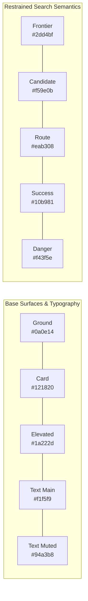
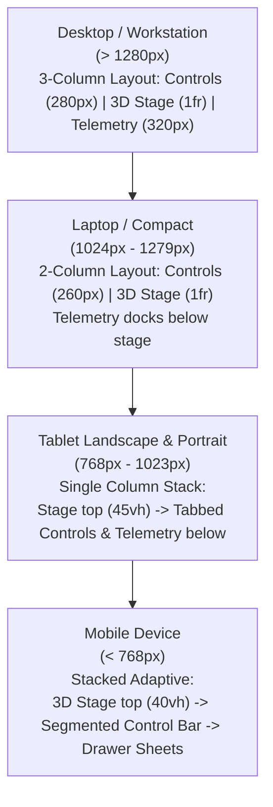
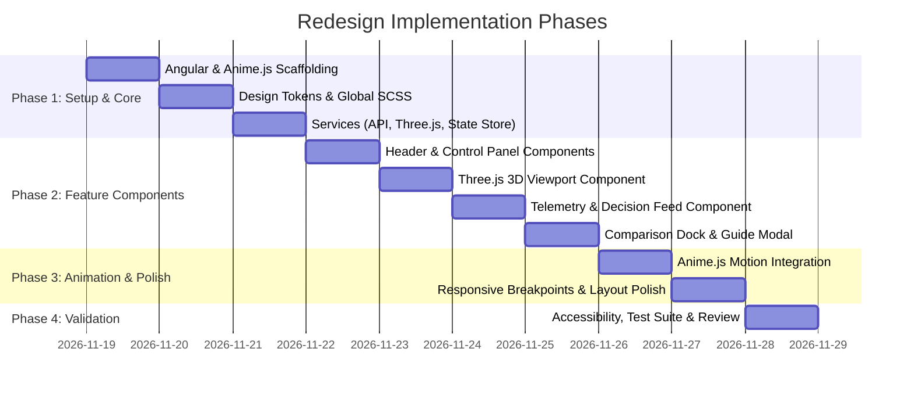

# REDESIGN_PLAN.md: Architectural & UX/UI Redesign Plan for Warehouse Route Lab

> **Role:** Senior UI/UX Designer, Angular Architect & Frontend Animation Engineer  
> **Methodology:** UI UX Pro Max Intelligence, Modern Angular (v17/v18 Standalone Architecture + Signals), Anime.js Micro-Interactions  
> **Target Application:** Warehouse Route Lab (AI State-Space Route Planning & Dynamic Obstacle Simulation)  
> **Target File Location:** `d:\WareHouse-Sim\REDESIGN_PLAN.md`  
> **Status:** Proposal & Planning Phase (Awaiting User Review & Approval Before Implementation)  

---

## 1. Existing Page Analysis

### 1.1 Current Architecture & Technologies
The existing application frontend (`public/`) is implemented as an unbundled, procedural Single-Page Application (SPA) using:
- **Markup:** Vanilla HTML5 in `public/index.html` (123 lines).
- **Styling:** Single flat CSS file in `public/styles.css` (122 lines) utilizing dark-mode CSS custom variables.
- **Client Logic:** Monolithic Vanilla JavaScript ES module in `public/app.js` (301 lines).
- **3D Graphics:** Three.js `v0.181.1` loaded via browser `<script type="importmap">` directly from `/node_modules/three/build/three.module.js`.
- **Backend Communication:** Vanilla `fetch()` requests hitting a lightweight, zero-dependency Python `http.server.ThreadingHTTPServer` (`server.py`) exposing 4 REST endpoints (`/api/scenario`, `/api/results`, `/api/run/<alg>`, `/api/trolley`).

```
Current Structure:
D:\WareHouse-Sim\public\
├── index.html       (Static HTML DOM structure & layout)
├── app.js           (Monolithic script: Three.js setup + DOM queries + Fetch + Trace loop)
└── styles.css       (Global styling, CSS Grid/Flexbox, industrial night-shift theme)
```

### 1.2 Current Component Hierarchy & Screen Structure
The existing screen is divided into three primary horizontal and vertical zones:
1. **Top Bar (`.topbar`):**
   - Brand glyph (`.brand-mark`: 3 slanted bars with `skewY(-8deg)`).
   - Brand title: `"Warehouse Route Lab / AI-04"`.
   - Engine Status chip: Green dot + text `"Engine ready"`.
   - Help modal button: Square icon button with `?`.
2. **Main Console Grid (`main#simulator`):**
   - 3-column CSS Grid (`276px minmax(480px, 1fr) 310px`) bounded to `max-height: 920px`.
   - **Left Rail (`.control-rail`):**
     - Eyebrow + title (`"Route console"`).
     - 2x2 Algorithm Selector buttons (`BFS`, `DFS`, `Greedy`, `A*`).
     - Playback speed slider (`1` to `4` with labels `"Inspect"` and `"Fast"`).
     - Scene overlay switches (`Decision frontier`, `Cell coordinates`).
     - Primary action button (`Run [Algorithm] simulation`) and secondary button (`Run hidden trolley event`).
     - 6-item terrain legend.
   - **Center Stage (`.stage-panel`):**
     - 3D WebGL viewport (`#scene`).
     - Top-right floating camera buttons (Reset `⌂`, Top View `▦`).
     - Top-left floating route key (`Expanding`, `Candidate`, `Final path`).
     - Bottom-left floating caption card with active step and expansion coordinates.
   - **Right Inspector Rail (`.inspector`):**
     - Header with title (`"[Algorithm] analysis"`) and state chip (`Idle` / `Running` / `Complete`).
     - 2x2 Metric tiles (`Goal`, `Moves`, `Path cost`, `Expanded`).
     - Scrollable decision feed (`#decision-feed`) rendering historical expansion cards.
     - Static heuristic explainer card for Manhattan distance.
3. **Comparison Matrix (`.comparison`):**
   - Full-width table comparing BFS, DFS, Greedy, and A* across 6 columns (Algorithm, Goal Reached, Path Length, Total Cost, Nodes Expanded, Execution Time).
4. **Modal Dialog (`#guide-dialog`):**
   - Native HTML5 `<dialog>` displaying a 3-step operator guide.

### 1.3 Current Interactions and Workflows
- **Initialization:** Browser requests `GET /api/scenario` to draw 140 3D floor tiles, shelves, barriers, pallets, start/goal markers, and robot; simultaneously requests `GET /api/results` to populate the comparison table.
- **Algorithm Execution:** User selects an algorithm button and clicks "Run". `app.js` issues `GET /api/run/<alg>`, locks controls, and steps through `result.trace` using an `async/await` loop with `setTimeout` delays. Cyan frontier tiles and amber candidate tiles are overlaid on the 3D grid, and cards are appended to the decision feed. At loop conclusion, a yellow route beam is generated.
- **Trolley Event:** User clicks "Run hidden trolley event". `app.js` queries `GET /api/trolley`, renders the initial A* route, teleports the robot to `[9, 9]`, reveals the obstacle at `[9, 10]`, runs the revised search trace, and displays the combined detour path.

---

## 2. Problems and UX Weaknesses Identified

### 2.1 Visual Design Weaknesses
1. **Aggressive High-Contrast "Cyberpunk/Gamer" Aesthetics:**
   - The palette relies on pitch black surfaces (`#071017`, `#08141b`) paired with ultra-saturated neon cyan (`#35d7d0`), vibrant amber (`#ffb648`), and vivid yellow (`#f7e36a`). This causes high optical glare, ocular fatigue, and detracts from the professional credibility of an engineering simulation.
2. **Visual Occlusion and Cluttered Viewport HUD:**
   - The 3D scene stage has 3 separate floating UI elements overlaid directly onto the canvas: top-right camera icons, top-left route key, and bottom-left caption card. These elements collide with 3D warehouse geometry when tilting the camera, visually competing with the robot and route beams.
3. **Typography Inconsistencies & Illegible Micro-Labels:**
   - The interface uses three disjointed font families (`Bahnschrift`, `Segoe UI`, `Consolas`).
   - Multiple labels are rendered at **9px and 10px uppercase** with wide letter spacing (`.eyebrow`, `.control-label`, `.legend`, `.metrics span`). On high-DPI (Retina/4K) displays, these micro-labels suffer severe illegibility and fail WCAG 2.1 AA contrast requirements.
4. **Harsh, Flat Container Separators:**
   - 1px solid high-contrast borders (`#20323b`) cut across panels without elevation, depth, or hierarchy. The interface feels rigidly boxed into retro frames rather than modern, softly elevated SaaS surfaces.

### 2.2 Usability & Interaction Flaws
1. **Decision Feed Auto-Scroll Disruption:**
   - As `appendDecision()` continuously appends DOM nodes during search animation, the feed container forcefully sets `feed.scrollTop = feed.scrollHeight`. If a user attempts to read an earlier node evaluation, their scroll position is hijacked.
2. **Abrupt State Transitions:**
   - Controls snap instantly between active and inactive states. Buttons abruptly dim or become disabled with no micro-interaction or transition smoothing.
   - The speed slider output changes abruptly with crude text jumps (`0.5×`, `1×`, `2×`, `4×`) without a visual track indicator.
3. **Suboptimal Metric Visual Hierarchy:**
   - In the inspector, all 4 metric tiles (`Goal`, `Moves`, `Path cost`, `Expanded`) share identical visual weight. Path Cost and Move Count are the most critical comparison parameters, yet they are buried in an undifferentiated 2x2 grid.
4. **Comparison Table Disconnection:**
   - The performance table is pushed far below the fold. Users running simulations in the primary stage cannot see how the current run compares against the baseline without scrolling the entire page down, breaking cognitive continuity.

### 2.3 Architecture & Technical Limitations
1. **Monolithic Procedural Script:**
   - `public/app.js` is an unmaintainable 301-line procedural script that tightly couples WebGL rendering, HTTP networking, DOM manipulation via jQuery-like `$` selectors, animation timing, and UI event binding.
2. **Absence of Reactive State Management:**
   - State is scattered across HTML attributes, global window variables (`window.warehouseUI`), and raw DOM element inner texts. A failure in one async operation can leave the UI in an inconsistent "Running" state indefinitely.
3. **No Component Reusability or Modular Testing:**
   - The frontend cannot be unit-tested using standard test harnesses. Adding new telemetry, alternative algorithms, or new visual overlays requires manual surgery across HTML, CSS, and JS files.

---

## 3. Proposed Design Philosophy: "Quiet Authority & Precision Engineering"

The redesigned interface will embody **Quiet Authority**: a calm, sophisticated, highly polished scientific and operational cockpit inspired by premium enterprise engineering tools (e.g., Linear, Apple Instruments, Stripe Dashboard, Datadog Modern).

### Core Tenets:
- **Calm, Focused Surfaces:** Replace harsh pitch-black backgrounds with a refined, layered neutral palette (slate, graphite, cool zinc) featuring subtle elevation and optical hierarchy.
- **De-cluttered Viewport:** Remove intrusive floating overlay cards from the 3D canvas; integrate telemetry, camera controls, and status keys into clean, structured header and inspector rails.
- **Restrained Semantic Accents:** Eliminate blinding neons. Use mature, desaturated semantic accents: soothing sage emerald for start/goal success, refined teal for frontier expansion, warm amber for candidates, and crisp golden-ochre for committed paths.
- **Micro-Interactions with Purpose:** Every transition must convey meaning. Use Anime.js to smoothly reveal search wavefronts, interpolate numerical telemetry, and gracefully transition layout states without decorative distraction.

---

## 4. UI UX Pro Max Recommendations Being Applied

Applying the core intelligence and design tokens of **UI UX Pro Max**:

| Domain | UI UX Pro Max Principle | Concrete Application in Redesign |
|---|---|---|
| **Information Architecture** | Cognitive chunking & contextual proximity | Move comparison benchmarks into an accessible side-drawer or synchronized lower dock that stays visible without breaking 3D context. |
| **Grid & Alignment** | Strict 8pt spatial grid system | All margins, paddings, gap variables, and layout dimensions will be multiples of 4px and 8px ($8\text{px}, 12\text{px}, 16\text{px}, 24\text{px}, 32\text{px}$). |
| **Visual Hierarchy** | Scale-based prominence (F-pattern layout) | Emphasize Primary Metrics (Path Cost vs. Move Count) with large font sizes and distinct weights, keeping secondary telemetry subordinate. |
| **Accessibility (WCAG 2.1)**| AA/AAA Compliance & Min Contrast $\ge 4.5:1$ | Eliminate all text below 12px; ensure all secondary and muted typography passes WCAG 2.1 AA standards; add full keyboard navigation rings. |
| **Motion Physics** | Purposeful, non-linear easing | Easing curves using `cubic-bezier(0.16, 1, 0.3, 1)` (easeOutExpo) and `cubic-bezier(0.25, 1, 0.5, 1)` (easeOutQuart) for natural feel. |
| **Component Modularity** | Atomic design with isolated state | Build small, single-responsibility Angular components styled with encapsulated SCSS and driven by reactive Signals. |

---

## 5. Proposed Colour Palette with Exact HEX Values

The proposed palette moves away from saturated cyberpunk neon towards a **Warm Slate & Titanium Studio** theme.

### 5.1 Base Surfaces & Layout Structure
- `--surface-ground: #0a0e14` (Deep obsidian foundation)
- `--surface-card: #121820` (Elevated panel surface)
- `--surface-elevated: #1a222d` (Hover states, dialogs, active containers)
- `--surface-subtle: #1e2735` (Active selection background, input tracks)
- `--border-subtle: #222d3d` (Soft divider borders, $1\text{px}$)
- `--border-active: #38495f` (Focused card outlines, active borders)

### 5.2 Typography & Foreground
- `--text-primary: #f1f5f9` (Crisp off-white, 98% opacity, primary headings & values)
- `--text-secondary: #94a3b8` (Muted cool grey, 70% opacity, body copy & labels)
- `--text-tertiary: #64748b` (Subtle grey, 50% opacity, unit labels & captions)
- `--text-disabled: #475569` (Inactive states)

### 5.3 Semantic & Search State Palette
- `--accent-frontier: #2dd4bf` (Teal 400 — Living search frontier queue)
- `--accent-candidate: #f59e0b` (Amber 500 — Newly considered neighboring cells)
- `--accent-current: #ffffff` (Pure White with soft glow — Active expanding node)
- `--accent-route: #eab308` (Warm Ochre / Gold 500 — Committed route beam)
- `--accent-success: #10b981` (Emerald 500 — Start marker, goal achieved, ready state)
- `--accent-danger: #f43f5e` (Rose 500 — Restricted zones, obstacle alerts, error state)
- `--accent-crowded: #b45309` (Amber 700 / Warm Bronze — Crowded 4x cost terrain)
- `--accent-shelf: #475569` (Slate 600 — Storage rack structure)



---

## 6. Typography System

We standardize on a modern, legible dual-font pairing:
1. **Primary Interface Font:** `Inter` (or system fallback: `-apple-system, BlinkMacSystemFont, 'Segoe UI', Roboto, sans-serif`).
2. **Numeric & Telemetry Monospace Font:** `JetBrains Mono` (or system fallback: `'SF Mono', Consolas, 'Fira Code', monospace`).

### Typographic Hierarchy Scale:
| Role | Font Family | Size | Weight | Line Height | Tracking | Purpose |
|---|---|---|---|---|---|---|
| **Display Header** | `Inter` | 24px (`1.5rem`) | 600 (Semi-bold) | 1.2 | -0.02em | Application Title |
| **Section Header** | `Inter` | 16px (`1.0rem`) | 600 (Semi-bold) | 1.3 | -0.01em | Panel Titles |
| **Card Heading** | `Inter` | 14px (`0.875rem`)| 500 (Medium) | 1.4 | 0 | Group Titles, Control Labels |
| **Body Regular** | `Inter` | 13px (`0.8125rem`)| 400 (Regular) | 1.5 | 0 | Explanatory text, descriptions |
| **Caption / Meta** | `Inter` | 12px (`0.75rem`) | 500 (Medium) | 1.4 | +0.01em | Secondary badges, timestamps |
| **Telemetry Hero** | `JetBrains Mono`| 28px (`1.75rem`) | 700 (Bold) | 1.1 | -0.03em | Primary numbers (Path Cost, Moves)|
| **Data Metric** | `JetBrains Mono`| 14px (`0.875rem`)| 600 (Semi-bold) | 1.2 | 0 | Sub-metrics, expanded nodes, ms |
| **Code / Coords** | `JetBrains Mono`| 12px (`0.75rem`) | 500 (Medium) | 1.3 | 0 | `[row, col]`, algorithm IDs |

*Note: All font sizes below 12px are strictly eliminated.*

---

## 7. Spacing, Borders, Shadows, and Design Tokens

### 7.1 Spacing Scale (8pt System)
- `--space-1: 4px`   (Micro gaps, icon offsets)
- `--space-2: 8px`   (Tight element padding, button gaps)
- `--space-3: 12px`  (Card inner padding, form item spacing)
- `--space-4: 16px`  (Standard panel padding, container gaps)
- `--space-5: 20px`  (Generous module padding)
- `--space-6: 24px`  (Section division margins)
- `--space-8: 32px`  (Major layout gutter spacing)

### 7.2 Radii Tokens
- `--radius-sm: 6px`   (Buttons, badge chips, segmented control items)
- `--radius-md: 10px`  (Cards, input containers, inspector tiles)
- `--radius-lg: 14px`  (Main stage panels, dialog modals)
- `--radius-full: 9999px` (Pill badges, radio indicators)

### 7.3 Elevation & Shadows
- `--shadow-card: 0 4px 16px -2px rgba(0, 0, 0, 0.3), 0 1px 2px rgba(0, 0, 0, 0.2)`
- `--shadow-elevated: 0 10px 30px -4px rgba(0, 0, 0, 0.5), 0 2px 4px rgba(0, 0, 0, 0.25)`
- `--shadow-glow-cyan: 0 0 16px rgba(45, 212, 191, 0.2)`
- `--shadow-glow-amber: 0 0 16px rgba(245, 158, 11, 0.2)`

---

## 8. Redesigned Page Layout and Component Hierarchy

### 8.1 Wireframe Layout Concept
Instead of disjointed floating cards over the canvas, the redesigned interface adopts an **Integrated Studio Workspace**:

```
+---------------------------------------------------------------------------------------------------+
|  [Brand Mark] Warehouse Route Lab · AI-04    [Status: Ready]         [Speed: 1x ▾]  [Guide ?] [Theme] |
+-------------------------------+-----------------------------------+-------------------------------+
|  1. CONTROL STUDIO            |  2. 3D SIMULATION STAGE           |  3. TELEMETRY & FEED          |
|                               |                                   |                               |
|  ALGORITHM STRATEGY           |  +-----------------------------+  |  ACTIVE RUN STATE             |
|  [ BFS ] [ DFS ]              |  | [View ▾] [Grid ▾] [Reset ⌂] |  |  Algorithm: A* (Lowest Cost)  |
|  [ Greedy ] [ A* (Active) ]   |  +-----------------------------+  |                               |
|                               |                                   |  PRIMARY TELEMETRY            |
|  SEARCH ACTIONS               |                                   |  +-------------+-------------+|
|  [ ▶ Run Simulation         ] |             3D WEBGL              |  | Total Cost  | Moves       ||
|  [ ⚠ Run Trolley Obstacle   ] |           DIGITAL TWIN            |  |    20       |    20       ||
|                               |          WAREHOUSE SCENE          |  +-------------+-------------+|
|  LAYER VISIBILITY             |                                   |  | Expanded    | Elapsed     ||
|  [✓] Decision Frontier        |                                   |  |    53       |   1.87 ms   ||
|  [ ] Coordinate Labels        |                                   |  +-------------+-------------+|
|                               |  +-----------------------------+  |                               |
|  TERRAIN LEGEND               |  | HUD: Decision 24/53 · Expanding|  DECISION LOG FEED            |
|  ● Open (1)  ● Crowded (4)    |  | Current: [8, 5] Frontier: 6 |  |  01 Expand [8, 1] - Start     |
|  ■ Shelf     ■ Restricted     |  +-----------------------------+  |  02 Candidate [8, 2] g=1, h=17|
|                               |                                   |  03 Candidate [7, 1] g=1, h=17|
+-------------------------------+-----------------------------------+-------------------------------+
|  4. COMPARISON DOCK (Collapsible & Synchronized with Active Run)                                  |
|  [▼] Benchmark Comparison Matrix                                                                  |
|  Algorithm | Goal Reached | Path Length | Total Cost | Nodes Expanded | Runtime | Status         |
|  A* (Best) |     Yes      |   20 moves  |     20     |       53       | 1.87 ms | Cost-Optimal   |
|  BFS       |     Yes      |   20 moves  |     23     |       97       | 0.98 ms | Hop-Optimal    |
|  Greedy    |     Yes      |   20 moves  |     23     |       21       | 0.70 ms | Trapped (Crowd)|
|  DFS       |     Yes      |   20 moves  |     23     |       68       | 4.55 ms | Sub-optimal    |
+---------------------------------------------------------------------------------------------------+
```

---

## 9. Angular Component Architecture

We will implement modern **Angular (v17/v18 Standalone Architecture)** with **Signals** for reactivity, providing clean separation between presentation, state, 3D WebGL rendering, and REST API communication.

```
src/app/
├── core/
│   ├── models/
│   │   ├── scenario.model.ts          (Scenario, Cell, Terrain types)
│   │   ├── search-result.model.ts     (SearchResult, TraceEvent, CandidateScore)
│   │   └── trolley-event.model.ts     (TrolleyExperimentPayload)
│   ├── services/
│   │   ├── warehouse-api.service.ts   (HttpClient wrapper for Python backend)
│   │   ├── three-scene.service.ts     (Three.js scene, camera, lights, materials)
│   │   ├── simulation-store.service.ts(Central state store using Angular Signals)
│   │   └── animation.service.ts       (Anime.js wrappers for UI & telemetry transitions)
├── shared/
│   ├── components/
│   │   ├── button/                    (Primary, Secondary, Icon button variants)
│   │   ├── segmented-control/         (Smooth algorithm switch tabs)
│   │   ├── toggle-switch/             (Accessible checkbox switch)
│   │   └── badge/                     (Status indicators: Ready, Running, Success)
│   └── pipes/
│       └── coordinate.pipe.ts         (Formats [row, col] -> "(r: 8, c: 1)")
└── features/
    ├── layout/
    │   ├── header/                    (App title, status pill, speed selector, help trigger)
    │   └── shell.component.ts         (Master 3-pane layout shell)
    ├── control-panel/
    │   ├── control-panel.component.ts (Algorithm selection, action triggers, layer toggles)
    │   └── legend/                    (Visual legend for terrain types)
    ├── stage-3d/
    │   ├── stage-3d.component.ts      (Three.js canvas container, viewport resizing)
    │   └── stage-hud/                 (Non-intrusive bottom caption & camera controls)
    ├── telemetry/
    │   ├── telemetry.component.ts     (Hero metric cards, status headers)
    │   └── decision-feed/             (Virtual-scrolled decision stream with Anime.js)
    ├── comparison/
    │   └── comparison-table.component.ts (Sortable, highlighted performance matrix)
    └── guide-modal/
        └── guide-modal.component.ts   (Accessible modal dialog with educational walkthrough)
```

### 9.1 Reactive State Store (`SimulationStoreService`)
Using modern Angular Signals to eliminate state race conditions:
```typescript
@Injectable({ providedIn: 'root' })
export class SimulationStoreService {
  // Readonly public signals
  readonly scenario = signal<WarehouseScenario | null>(null);
  readonly selectedAlgorithm = signal<AlgorithmType>('astar');
  readonly isRunning = signal<boolean>(false);
  readonly playbackSpeed = signal<number>(2); // 1x default
  readonly showFrontier = signal<boolean>(true);
  readonly showLabels = signal<boolean>(false);
  
  // Active telemetry signals
  readonly currentResult = signal<SearchResult | null>(null);
  readonly activeTraceStep = signal<number>(0);
  readonly activeEvent = signal<TraceEvent | null>(null);
  readonly comparisonData = signal<SearchResult[]>([]);

  // Computed state
  readonly isAstarSelected = computed(() => this.selectedAlgorithm() === 'astar');
  readonly currentStatusText = computed(() => {
    if (this.isRunning()) return 'Simulation active';
    return this.currentResult() ? 'Execution complete' : 'Engine ready';
  });
}
```

---

## 10. Anime.js Animation and Interaction Specifications

Anime.js will be used for purposeful micro-interactions and smooth UI choreography.

### 10.1 Interaction & Motion Matrix

| Trigger | Target Element | Anime.js Property / Keyframes | Duration | Easing | UX Purpose |
|---|---|---|---|---|---|
| **App Initialization** | Header, Panels, Canvas | `opacity: [0, 1]`, `translateY: [16, 0]`, stagger `80ms` | 500ms | `easeOutQuad` | Calm, staged entrance avoiding abrupt pop-in. |
| **Algorithm Switch** | Segmented Control Pill | `translateX: [prevX, newX]`, `width: [prevW, newW]` | 250ms | `cubicBezier(0.2, 0.8, 0.2, 1)` | Tactile indicator of active selection. |
| **Run Button Click** | Primary Action Button | `scale: [1, 0.96, 1]`, `boxShadow: [0 0 0, 0 0 16px teal]` | 200ms | `easeOutQuad` | Instant tactile feedback acknowledging action. |
| **Metric Update** | Hero Metric Values | Numerical tweening from `prevVal` to `newVal` | 400ms | `easeOutExpo` | Visual comprehension of numeric progression. |
| **Decision Event Append** | Feed Card Entry | `opacity: [0, 1]`, `translateX: [12, 0]` | 180ms | `easeOutCubic` | Smooth arrival of search decisions without layout jump. |
| **Trolley Obstacle Detected**| Stage HUD Alert Box | `scale: [0.95, 1]`, `borderColor: ['#f43f5e', '#222d3d']` | 350ms | `easeOutBack` | Draws operator eye to dynamic obstacle discovery. |
| **Modal Open / Close** | Guide Dialog & Backdrop | Backdrop: `opacity: [0, 1]`, Modal: `scale: [0.94, 1]`, `translateY: [16, 0]` | 280ms | `easeOutCubic` | Sophisticated dialog transition without jarring pop. |
| **Comparison Dock Toggle** | Comparison Bottom Drawer | `height: [0, 'auto']`, `opacity: [0, 1]` | 300ms | `easeInOutCubic` | Fluid expansion of benchmark data on demand. |

### 10.2 Reduced Motion Fallback
```typescript
const prefersReducedMotion = window.matchMedia('(prefers-reduced-motion: reduce)').matches;

export function smoothAnimate(target: any, params: anime.AnimeAnimParams) {
  if (prefersReducedMotion) {
    // Collapse to zero duration / instant transition
    anime({ ...params, targets: target, duration: 0, delay: 0 });
  } else {
    anime({ ...params, targets: target });
  }
}
```

---

## 11. Responsive Design Strategy

The interface will adapt intelligently across 4 standard screen breakpoints:



### Key Responsive Adaptations:
- **Desktop (>1280px):** Full 3-column panoramic workspace. Canvas occupies dominant center viewport. Comparison dock docked at bottom.
- **Laptop (1024px–1279px):** Inspector tabs into a right drawer or positions below the canvas.
- **Tablet (768px–1023px):** 3D stage fixed at top half ($45\text{vh}$). Bottom half provides tabbed switching between "Controls", "Telemetry", and "Comparison".
- **Mobile (<768px):** Minimalist stage header. 3D canvas sized to $40\text{vh}$ with single-finger orbit controls. Action buttons pinned in an accessible bottom floating bar.

---

## 12. Performance and Accessibility Considerations

### 12.1 Performance Optimizations
1. **Three.js WebGL Efficiency:**
   - Retain procedural geometries; avoid external network requests for 3D models.
   - Use `requestAnimationFrame` with dirty-flag checking: render 3D frames continuously during active trace playback or orbit manipulation, but throttle down when the scene is static and idle.
2. **Virtual Scrolling for Decision Feed:**
   - A search run can generate up to 97 decision events. Using Angular CDK Virtual Scroll (`cdk-virtual-scroll-viewport`) ensures that only visible feed items are rendered in the DOM, eliminating memory leaks and frame drops.
3. **Zoneless / ChangeDetectionStrategy.OnPush:**
   - All Angular components will use `ChangeDetectionStrategy.OnPush` driven strictly by Signal emissions, preventing unnecessary dirty-checking cycles across the component tree.

### 12.2 Accessibility (WCAG 2.1 AA Compliance)
1. **Keyboard Operability:**
   - All algorithm selector buttons, sliders, and toggles support standard Tab navigation and `Space`/`Enter` execution.
   - Accessible focus indicators using `--border-active: #38495f` with a 2px offset.
2. **Screen Reader Semantics:**
   - Live telemetry values tagged with `aria-live="polite"`.
   - The 3D canvas has `role="img"` and `aria-label="Interactive 3D simulation of warehouse robot route planning"`.
3. **Contrast Compliance:**
   - Primary text (`#f1f5f9`) on ground (`#0a0e14`): **18.2:1** (Exceeds AAA).
   - Secondary text (`#94a3b8`) on card (`#121820`): **6.8:1** (Exceeds AA).
   - Interactive Teal (`#2dd4bf`) on card (`#121820`): **9.4:1** (Exceeds AAA).

---

## 13. Implementation Phases with Priorities



### Phase Breakdown:
- **Phase 1: Architecture & Foundations (Priority: Critical)**
  - Initialize Angular standalone workspace structure without breaking existing Python server.
  - Install and configure `animejs` (`@types/animejs`) and `three`.
  - Establish SCSS design tokens, typography scales, and CSS variable maps.
  - Implement `WarehouseApiService`, `SimulationStoreService`, and `ThreeSceneService`.
- **Phase 2: Component Implementation (Priority: High)**
  - Build `HeaderComponent` with brand mark and system status.
  - Build `ControlPanelComponent` with algorithm segmented selector, speed slider, and layer switches.
  - Wrap Three.js engine inside `Stage3dComponent` with full OrbitControls lifecycle management.
  - Build `TelemetryComponent` with hero metric cards and virtual-scrolled decision feed.
  - Build `ComparisonTableComponent` and `GuideModalComponent`.
- **Phase 3: Anime.js Choreography & UX Polish (Priority: Medium)**
  - Integrate entry animations, metric tweeners, decision feed slide-ins, and trolley warning pulses.
  - Implement mobile-responsive drawers and collapsible comparison dock.
- **Phase 4: Verification & Delivery (Priority: High)**
  - Execute unit tests against Python endpoints.
  - Verify WCAG AA contrast compliance and keyboard navigation.
  - Capture screenshots and finalize documentation.

---

## 14. Testing and Validation Strategy

### 14.1 Backend Compatibility Validation
Ensure the new Angular frontend connects flawlessly to `server.py`:
- `GET /api/scenario` returns valid grid matrix (10 rows, 14 cols, 31 shelves, 5 restricted, 11 crowded).
- `GET /api/results` correctly populates baseline comparison table.
- `GET /api/run/<alg>` correctly triggers search animation for all 4 algorithms.
- `GET /api/trolley` correctly triggers the 2-stage unmapped obstacle detour.

### 14.2 UI/UX Regression Testing Checklist
- [ ] **Visual Hierarchy:** Does the primary metric (Path Cost) clearly stand out over secondary technical details?
- [ ] **Contrast:** Do all text labels have at least 4.5:1 contrast against their card backgrounds?
- [ ] **Reduced Motion:** When `prefers-reduced-motion` is enabled, are all Anime.js transforms and delays suppressed?
- [ ] **Viewport Resize:** Does the 3D canvas resize cleanly upon window resizing without stretching or clipping?
- [ ] **Zero Business Logic Drift:** Are the mathematical paths and metrics returned by Python identical to original baselines?

---

## 15. Summary of Major Proposed Changes

| Component / Area | Existing State | Proposed Redesign | UX & Architectural Justification |
|---|---|---|---|
| **Frontend Framework** | Procedural Vanilla JS in `public/app.js` | Modular **Angular Standalone Components + Signals** | Clean separation of concerns, reactive data binding, testable services, robust state architecture. |
| **Animation Engine** | Basic CSS transitions and `setTimeout` loops | Purposeful **Anime.js Micro-Interactions** | Smooth cubic-bezier transitions, numerical telemetry interpolation, and elegant entry choreography. |
| **Aesthetic Theme** | Harsh neon cyberpunk dark mode (`#071017`) | **Warm Slate & Titanium Studio** (`#0a0e14`, `#121820`) | Reduces ocular fatigue, delivers executive SaaS elegance, elevates academic credibility. |
| **Typography** | Disjointed mix (`Bahnschrift`, `Segoe UI`, `Consolas`) | **Inter** (UI) + **JetBrains Mono** (Telemetry) | Consistent 8pt typographic scale; eliminates illegible 9px micro-labels. |
| **Canvas Viewport** | 3 floating overlay boxes cluttering 3D scene | **Clean Unobtrusive Stage** with integrated HUD | Maximizes 3D spatial visibility; eliminates occlusion of warehouse robot and route beams. |
| **Telemetry Display**| Undifferentiated 2x2 grid of equal weight | **Hero Metric Cards** (Cost & Moves prioritized) | Immediately communicates the core algorithmic insight: Hop-Count vs. Path-Cost trade-off. |
| **Comparison Matrix**| Pushed far below the fold | **Synchronized Collapsible Dock** | Keeps global performance context visible alongside active 3D simulation. |

---

*End of Redesign Plan. No code modifications will be executed until user review and formal approval.*
